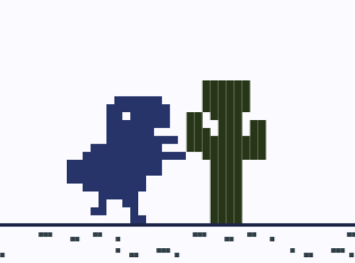
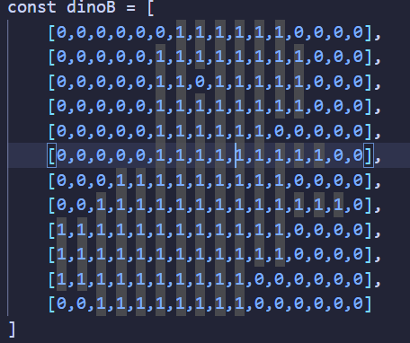

# Dino's world

It's a game **INSPIRED**✨, just **INSPIRED**✨ from Google's official offline game aka da T-Rex. Although it was **INSPIRED**✨ by it, it contains quite unique features too which makes this **INSPIRED**✨ game *~~better~~* dino game.

Here's a pic of our dino going to hug Mr Cactus -- His best friend --



## What's different??
* it's just cool 😎 bro
* You can just paste the url and it will work! <br> **yahh you heard it right**, just paste in your browser of choice and you are good to go, works offline or even in **phone**
* has unique things like: **Did you know** dino can jump ;)
<br> just kiddin, beside the jokes, it can also air jump (time it properly and you can have yourself a 2nd chance)
* **Chaos mode**: bascially when you look at the score thingy, you can see a second number `{your_score}/{sum_number}` and if you reach that targeted `{sum_number}`, a chaotic mode will be activated where colors inverts and game becomes faster paced for few seconds!
* what you still lookin for?? just go and play!
* cool feature: try clicking the text `Dino's world` in the game

## How to play??
**Paste this in your favourate browser!**
```
data:text/html,<body><h1>Dino's worlddddd</h1><canvas width="854" height="480" id="c"></canvas><style>body{background-color:%2330343f;color:%23e4d9ff;font-family:monospace;text-align:center}canvas{background-color:%23fafaff}</style><script>document.querySelector("h1").onclick=()=>alert("woaa!");const t=document.getElementById("c");t.style.transition="filter 2s";const e=t.getContext("2d"),l=[1008,2040,1784,2040,2016,2044,8176,16382,65520,65520,65472,16320],o=[3968,3456,2304,3456],n=[3968,3200,2240,3072],i=[3968,2432,6272,192],c=[{s:[126,60,153,219,255,255,126,60,60,60,60,60],cols:8,w:56,h:84,y:346},{s:[114736,114736,246259,258559,258559,127228,114736,114736,114736,114736,114736,114736],cols:18,w:126,h:84,y:346},{s:[252,252,252,252,888,827,955,1023,1023,255,120,120,120,120,120,120,120,120],cols:10,w:70,h:126,y:304}],f=[1792,4044,32766,65535,16380],r=[384,960,2016,4080,8184,16380,32766,65535],s=[1835392,12296],a=[16440,3074],y=[3088];let h={x:300,y:318,w:112,h:112,v:0,g:.8,j:17,ig:!1},x=[],d=10,w=0,u=100,g=!1,m=0,p=0,v=0,S=R(),A=0;function R(){return 200+~~(300*Math.random())}function C(t,l,o,n,i,c=7){e.fillStyle=i,t.forEach((t,i)=>{for(let f=0;f<l;f++)t>>l-1-f&1&&e.fillRect(o+f*c,n+i*c,c,c)})}function E(t,e,l,o,n,i,c){const f=e*o+i;for(let i=-p*n%25f;i<854;i+=f)C(t,e,i,l,c,o)}function M(t,e){return t.x+20<e.x+e.w&&t.x+t.w-20>e.x&&t.y+20<e.y+e.h&&t.y+t.h-20>e.y}function T(){if(g)return x=[],w=0,g=!1,h.y=318,h.v=0,m=0,v=0,S=R(),A=0,void b();!h.ig&&A||(h.v=-h.j,h.ig||(A=300))}function b(){if(e.clearRect(0,0,t.width,t.height),e.font="20px monospace",e.textAlign="right",e.fillText(`${~~m} \\ ${v?"CHAOSSSS":S}`,840,30),e.font="14px monospace",e.fillStyle=A?"%23aab":"%231e2749",e.fillText("air jump - "+(A?1+~~(A/60)+"s":"available"),840,50),p+=d,E(r,16,318,14,.1,400,"%23e09f3e"),E(f,16,50,5,.2,300,"%23bde0fe"),E(f,16,140,5,.35,500,"%23a2d2ff"),E(s,24,438,4,1,40,"%232f3e46"),E(a,16,452,4,1,90,"%232f3e46"),E(y,12,466,4,1,170,"%231e2749"),m+=.15,A&&A--,!v&&m>=S&&(v=m+150),v&&m>=v&&(v=0,S=~~m+R()),t.style.filter=v?"invert(1)":"",d=10+Math.min(4,m/150)+(v&&2),h.v+=h.g,h.y+=h.v,h.ig=h.y>=318,h.ig&&(h.y=318,h.v=0),w++,w>=u){const t=c[~~(3*Math.random())];x.push({x:854,y:t.y,w:t.w,h:t.h,s:t.s,cols:t.cols}),w=0,u=(60+~~(60*Math.random()))*(v?.7:1)}for(let l=x.length-1;l>=0;l--){if(x[l].x-=d,C(x[l].s,x[l].cols,x[l].x,x[l].y,"%23283618"),M(h,x[l]))return g=!0,e.clearRect(0,0,t.width,t.height),e.fillStyle="%231e2749",e.font="monospace bold 36px",e.textAlign="center",e.fillText("GAME OVER!",427,200),e.fillText("Score: "+~~m,427,240),void e.fillText("Press SPACE or CLICK to Restart",427,280);x[l].x+x[l].w<0&&x.splice(l,1)}e.fillStyle="%231e2749",e.fillRect(0,430,t.width,3),C(l.concat(h.ig?[n,i][~~m%252]:o),16,h.x,h.y,"%23273469"),requestAnimationFrame(b)}window.onpointerdown=T,window.onkeydown=t=>" "===t.key&&(t.preventDefault(),T()),b();</script></body>
```


## Cool point:
* its below 3kb!
* everything is in that url! even **the art!!!**
<br>
APPRECIATE IT! it took me a long time to make it!


## For nerds:
* It uses url's inline html feature.
* You can check out `/src` for the codes
* About how I designed art: heres a cool ss


> <br>and before you say, yah! only its leg is animated. <br>
and another question might be: I don't see this in the `index.html` nor the url??
<br> <br>=> Cuz I compressed that into numbers, like we can see that it can be represented as binary so i just converted that binary into decimal for storing efficiently!

* Yah and rest all details you can see it yourself!